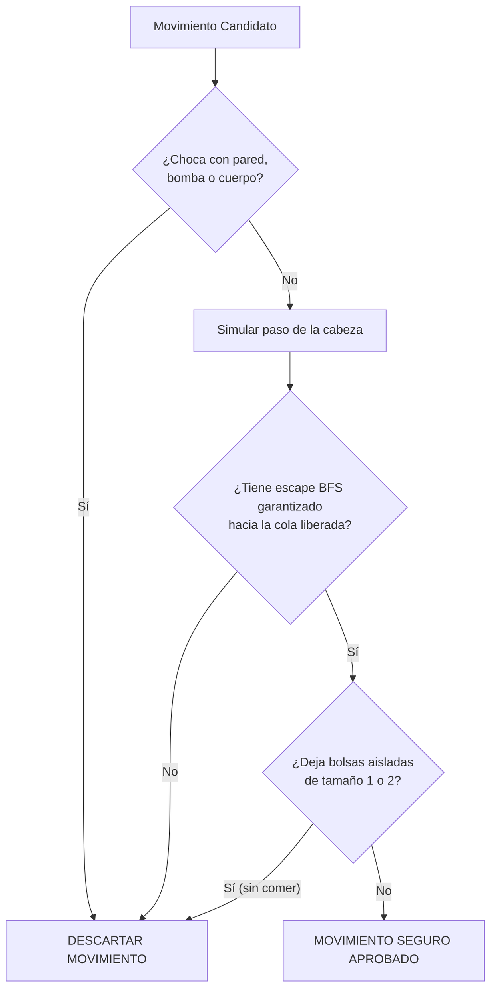
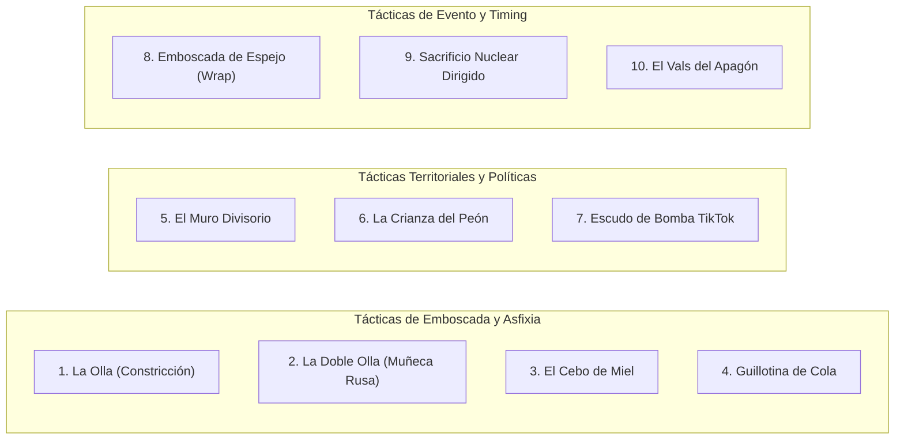

# Bases.md — Normas y Fundamentos Sagrados del Proyecto

Este documento establece las **Bases y Mandamientos Inamovibles** de la lógica, el comportamiento de las serpientes y el diseño del juego. Estas normas no son sugerencias: son los pilares sobre los cuales se sostiene todo el proyecto.

---

## 1. La Regla de Oro: Tolerancia Cero al Suicidio Involuntario

> [!IMPORTANT]
> **REGLA #1 DE TODA SERPIENTE**:
> **Ninguna serpiente puede morir por sí misma.**

1. **Cuándo es válida una muerte**:
   - Únicamente por **factores externos** e imprevisibles:
     - Bombas colocadas repentinamente por la audiencia de TikTok.
     - Detonaciones de Bombas Atómicas en su radio de impacto.
     - Spawns masivos de manzanas o trampas en su trayectoria inmediata que alteren drásticamente las condiciones.
     - En modos multijugador: si otra serpiente viva le corta el paso o maniobra para encerrarla tácticamente.
2. **Cuándo es un fallo inaceptable del sistema**:
   - Chocar contra una pared sólida en solitario sin factores externos.
   - Chocar contra su propio cuerpo.
   - Chocar contra su propia cola por no calcular si estaba fija o en movimiento.
   - Adentrarse en un callejón sin salida (bolsa de vacío) sin haber verificado previamente una ruta de escape garantizada.

---

## 2. El Mandato Algorítmico de Escape Seguro (`_has_escape`)

Para que la **Regla #1** se cumpla sin excepción, todo movimiento propuesto por cualquier bot debe cumplir el siguiente protocolo estricto:

1. **Verificación de Retorno a la Cola**:
   - Antes de dar un paso, el bot debe simular la posición futura del cuerpo y ejecutar una búsqueda en anchura (**BFS**) que certifique que la nueva posición de la cabeza tiene un camino completamente despejado hacia la cola de la serpiente.
   - Si un paso hacia una manzana apetitosa no tiene escape a la cola, **está prohibido darlo**. La serpiente debe preferir dar un rodeo seguro o seguir el patrón antes que arriesgar su vida.
2. **Detección de Bolsas Vacías (`_small_empty_components_penalty`)**:
   - Ningún bot puede crear divisiones en el tablero que dejen cavidades de tamaño 1 o 2 celdas donde la serpiente futura no pueda maniobrar.
   - Excepción sagrada: Si el movimiento consume comida o bomba dorada, la penalización se anula para no estancar al bot en las esquinas.
3. **Consciencia Temporal de Eventos**:
   - Si un modo temporal (como el Modo Trascendente / Sin Paredes) está activo, el bot debe monitorear el temporizador del evento.
   - Si faltan menos de **1.5 segundos** para que se cierren los portales del borde, el bot debe actuar como si los muros ya fueran sólidos para evitar ser cortado por el cambio de reglas.

---

## 3. Normas Inamovibles de la Interfaz Visual (HUD y Menús)

1. **Ajuste y Escalabilidad de Texto**:
   - **Ningún texto puede salirse de la ventana ni aparecer cortado.**
   - Todas las fuentes, títulos, descripciones y paneles deben dimensionarse con respecto al ancho real de la ventana (`surface.get_width()`).
   - Las pantallas de menús, controles y guías deben utilizar saltos de línea y márgenes seguros.
2. **El Panel Superior (HUD) Estricto**:
   - En el juego, el HUD superior debe contener **única y exclusivamente** los siguientes 5 elementos esenciales:
     1. **Estado de TikTok**: `[TIKTOK: LIVE]` (verde) o `[TIKTOK: ESPERA]` (amarillo) con LED circular.
     2. **Modo de Juego**: Nombre limpio del modo actual (`BATTLE ROYALE`, `DUELO 1V1`, `HIPNÓTICO`, `SPEEDRUN`).
     3. **FPS**: Velocidad lógica en fotogramas por segundo.
     4. **Nombre del Patrón**: Patrón activo o estilo de navegación.
     5. **Evento Activo**: Si hay evento en curso (`GOLDEN`, `TRASCENDENTE`, `RAINBOW / ÉXTASIS`), con contador regresivo en segundos (`3.4s`), o `NINGUNO` si el estado es normal.
   - **Prohibido**: Saturar el HUD con estadísticas individuales excesivas, nombres apiñados o tablas que se solapen con la cuadrícula.

---

## 4. Filosofía del Entretenimiento y la Audiencia

1. **La Supervivencia es el Show**:
   - Una serpiente que muere a los 5 segundos aburre al público y destruye la experiencia de streaming.
   - Las serpientes deben lucir maestras, inteligentes y casi inmortales en condiciones estándar, obligando a la audiencia a colaborar o donar regalos para intentar derrotarlas o alterar el curso del juego.
2. **Personalidades Progresivas**:
   - La personalidad de una serpiente (kamikaze, territorial, conservadora) debe manifestarse en su estilo de juego y en situaciones de alta presión, pero **nunca** por encima de su instinto básico de supervivencia.

---

## 5. El Compendio Táctico Maquiavélico (Las 10 Maniobras de Combate)

Estas 10 tácticas maestras definen el cerebro estratégico de alto nivel del **Jinete**. Cada maniobra combina geometría espacial, psicología de intimidación y explotación de las mecánicas de streaming:

### 1. La Olla Clásica (*The Constriction Pot*)
* **Mecánica**: Una serpiente de longitud $\ge 16$ traza una espiral abierta o geometría en "U", simulando un callejón apetitoso (a menudo con comida al fondo).
* **El Gatillo**: En el tick en que la víctima cruza el umbral de entrada, la serpiente cierra la puerta girando hacia su propio cuerpo exterior y reduce concéntricamente el radio en cada vuelta.
* **Resultado**: La víctima colapsa cuando el espacio interior libre es inferior a su propia longitud.

### 2. La Doble Olla (*The Russian Doll Trap / El Cazador Cazado*)
* **Mecánica**: Mientras la Serpiente A está ocupada ejecutando la "Olla" sobre la Serpiente B (con su cuerpo comprometido en un bucle cerrado y predecible), la Serpiente C interviene desde la periferia.
* **El Giro**: La Serpiente C envuelve externamente a la Serpiente A.
* **Resultado**: Espectáculo visual supremo en tres capas concéntricas: B muere asfixiada por A, pero A descubre que está atrapada dentro de C sin salida al exterior.

### 3. El Cebo de Miel (*The Honey Trap*)
* **Mecánica**: La serpiente finge desinterés ante una manzana en zona disputada y se coloca en un carril paralelo.
* **El Gatillo**: Cuando el rival hambriento acelera en línea recta hacia la manzana, la serpiente corta la trayectoria en perpendicular justo 1 tick antes de que la víctima alcance la comida, provocando un choque frontal letal.

### 4. La Guillotina de Cola (*The Tail Guillotine / Fake Retreat*)
* **Mecánica**: La serpiente simula estar acorralada huyendo pegada al muro con un rival persiguiéndola a corta distancia.
* **El Giro**: La serpiente que huye realiza un giro cerrado de 180° pasando a milímetros de su propia cola en movimiento.
* **Resultado**: Como el perseguidor no tiene radio de giro ni tiempo de reacción suficiente, se estrella de lleno contra el cuerpo o la cola de la serpiente líder.

### 5. El Muro Divisorio y la Guerra por Encargo (*Proxy War Partition*)
* **Mecánica**: Una serpiente dominante en longitud traza una barrera ortogonal continua a través del centro del Coliseo.
* **El Reparto**: Reclama el 70% del mapa para sí misma, comprimiendo a dos rivales en el 30% restante.
* **Resultado**: Al no haber espacio vital para dos serpientes en ese cuadrante, ambas se ven forzadas a destruirse mutuamente mientras el líder come tranquilamente en su mitad.

### 6. La Crianza del Peón / Balance Maquiavélico (*The Kingmaker Maneuver*)
* **Mecánica**: Si en la arena hay un líder gigante (longitud 25), dos medianas peligrosas (longitud 15 cada una) y una pequeña inofensiva (longitud 6).
* **El Cálculo**: El líder ignora y protege implícitamente a la pequeña en lugar de matarla. Si matara a la pequeña, una de las medianas absorbería su espacio y se convertiría en una amenaza simétrica.
* **Resultado**: La pequeña actúa como un estorbo y distracción constante para las dos medianas, permitiendo al líder rematar a la superviviente en el juego tardío.

### 7. El Escudo de Bomba de TikTok (*The Bomb Human Shield*)
* **Mecánica**: Cuando la audiencia arroja una bomba de regalo con temporizador de 5 segundos, la serpiente se enrolla formando un semi-círculo alrededor de ella.
* **El Uso**: Utiliza la bomba como torreta defensiva que impide el acceso a cualquier rival.
* **La Fuga**: Faltando 0.5s para la detonación, desenrolla su cuerpo y escapa por su carril de holgura previamente asegurado.

### 8. La Emboscada de Espejo (*The Wrap-Around Mirror Ambush*)
* **Mecánica**: Exclusiva del **Modo Trascendente (Sin Paredes)**.
* **La Jugada**: Al detectar a un rival pegado al borde derecho del mapa, la serpiente no cruza el tablero: se zambulle en el borde izquierdo y "se teletransporta" emergiendo por la espalda del rival a corta distancia.

### 9. El Sacrificio Nuclear Dirigido (*The Nuclear Kamikaze Vector*)
* **Mecánica**: Durante la cinemática de descenso de la Bomba Atómica (radio de 6 casillas).
* **La Jugada**: En lugar de simplemente correr, la serpiente se interpone en la ruta de escape del rival hacia el cuadrante frío, forzando a la víctima a quedar dentro del radio de ignición térmica mientras ella salta fuera en el último tick.

### 10. El Vals del Apagón (*The Time-Out Standoff*)
* **Mecánica**: Cuando un rival gigante se encuentra en **Modo Dorado** (invulnerable) y persigue a una serpiente ágil.
* **La Danza**: La serpiente defensiva quema tiempo mediante figuras en "ocho" y bucles cerrados de alta holgura.
* **El Contragolpe**: En el instante milimétrico en que el contador del Modo Dorado rival expira y pierde la invulnerabilidad, la serpiente defensiva gira y corta el paso al titán ahora mortal.

