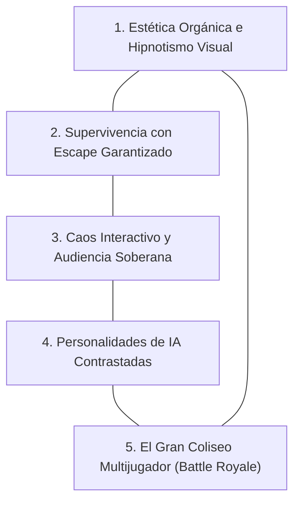

# Vision.md — Bases e Inamovibles del Proyecto

Este documento establece la identidad, la filosofía de diseño y los pilares fundamentales que rigen el proyecto **Snake — Bot Focused & TikTok Colosseum**. Cualquier evolución, refactorización o adición futura debe someterse y alinearse rigurosamente con estos principios.

---

## 1. Identidad Fundamental

### ¿Qué es este proyecto?
Es un **espectáculo interactivo de entretenimiento algorítmico y streaming en vivo**. Combina el clásico juego de la serpiente con una Inteligencia Artificial híbrida (geométrica, heurística y psicológica) que juega de forma hipnótica ante una audiencia en vivo (TikTok Live / TikTok Studio), adaptándose en tiempo real al caos y las dinámicas desatadas por los espectadores a través de donaciones, regalos y eventos externos.

### ¿Qué NO es este proyecto?
- **No es un simple clon de Snake para teclado**: Aunque cuenta con controles manuales para pruebas, el núcleo está concebido para ser observado e intervenido por una comunidad en vivo.
- **No es un solver matemático aburrido**: Un bot que solo calcula la ruta más corta (BFS / A*) muere rápidamente al crecer o luce torpe y caótico; un ciclo hamiltoniano rígido tarda minutos interminables en cruzar la pantalla y aburre a la audiencia. Nuestro bot prioriza la belleza del movimiento, el drama de la supervivencia y la emoción del juego.
- **No es una caja negra opaca de Deep Learning**: Se basa en matemáticas discretas, grafos, heurísticas espaciales y autómatas de decisión instantáneos, garantizando fluidez a 60 FPS sin microtirones ni latencia.

---

## 2. Los 5 Pilares Inamovibles (Nuestras Bases)

### Pilar 1: Estética Orgánica e Hipnotismo Visual
- **La criatura debe sentirse viva, no una tira de bloques**: 
  - La serpiente no es una cadena de píxeles o círculos inconexos; es un reptil estilizado y continuo con curvatura fluida.
  - **Adelgazamiento cónico de la cola**: El último 10% a 15% del cuerpo debe estrecharse suavemente hacia la punta para simbolizar una cola natural.
  - **Rostro expresivo**: Ojos dinámicos con pupilas que siguen y observan la manzana más cercana, parpadeos aleatorios y lengua bífida retráctil que asoma al rastrear comida o detectar peligro.
- **Objetos con volumen y vida cinemática**:
  - **Manzanas clásicas**: Sombreado esférico con volumen, brillo especular y hoja con textura.
  - **Manzanas doradas**: Aura luminosa pulsante (*glow effect*) que respira mediante ondas sinusoidales.
  - **Bombas estándar**: Mecha con chispas de combustión animadas y detonación expansiva con partículas de humo y fuego.
  - **Bomba Atómica / Nuclear**: Evento cinemático mayor con alerta, caída vertical de ojiva, impacto en el centro y onda expansiva destructiva en anillos concéntricos con 3 fases térmicas (fuego incandescente → ceniza → carbón quemado).
- **Modos Visuales Sagrados**:
  - **Modo Sin Paredes (Wrap / Místico)**: Piel morada/neón violeta con portales cósmicos tenues en los bordes por donde cruza.
  - **Modo Éxtasis**: Río de luz arcoíris cromático continuo que recorre dinámicamente todo el cuerpo.
  - **Modo Dorado**: Coraza metálica resplandeciente, invulnerabilidad a explosiones y capacidad de devorar bombas por doble puntuación.

### Pilar 2: Supervivencia Algorítmica con Escape Garantizado
- **Regla de Oro de Evacuación (`_has_escape`)**: La cabeza jamás dará un paso hacia una celda que no tenga un camino garantizado (vía BFS) hacia la posición liberada de su propia cola.
- **Tolerancia Cero al Suicidio Involuntario**: Si el bot no tiene escapatoria limpia, entra en modo de retraso de muerte (`_best_delay_death_move`), eligiendo la casilla con más vecinos libres para prolongar el espectáculo.
- **Fix de Esquinas Sagrado**: Cuando una casilla contenga comida o bomba en modo dorado, la penalización de componentes pequeños queda anulada para evitar que la serpiente vacile o se ahogue frente a una manzana arrinconada.

### Pilar 3: Caos Interactivo y Soberanía de la Audiencia
- **El juego existe para ser perturbado en tiempo real**: Los espectadores en TikTok Live tienen el poder de cambiar el destino de la partida mediante regalos y donaciones.
- **Reconocimiento Comunitario**: El HUD de transmisión siempre mantendrá visible el nombre del último donante o usuario participante (`last_donor`) y el estado de la conexión en vivo.
- **Desacoplamiento Event-Driven**: El motor del juego nunca se ata directamente a una red específica; recibe eventos mediante un `EventBus` agnóstico por UDP/JSON.

### Pilar 4: Personalidades de IA Contrastadas
El bot no es una sola mente monótona. El proyecto se basa en perfiles de personalidad distinguibles:
1. **La Conservadora / Perfeccionista**: Fiel a los patrones geométricos, extremadamente precavida, toma rutas largas y seguras.
2. **La Kamikaze / Speedrunner**: Hambrienta, agresiva, busca el camino más corto hacia la comida y asume riesgos extremos ante bombas o factores externos.
3. **La Territorial / Dominante**: Prioriza acordonar el espacio, controlar el centro del mapa y restringir el movimiento del entorno.
4. **La Caótica**: Alterna impredeciblemente entre patrones y desvíos rápidos, ideal para desconcertar al público.

### Pilar 5: El Coliseo Multijugador (Battle Royale de Streaming)
- **La meta cumbre del proyecto**: Una cuadrícula expandida (ej. $24 \times 24$ o $32 \times 32$) donde **2 a 4 serpientes con personalidades diferentes compiten simultáneamente** en pantalla.
- **Facciones de TikTok**: La audiencia puede alinearse con facciones (Team Rojo, Team Azul, Team Dorado, Team Púrpura), enviando regalos para beneficiar a su serpiente protegida (escudos, velocidad, comida) o bombardear el camino de las rivales.

---

## 3. El Contrato Visual (Identidad Gráfica)

1. **Tablero**: Cuadrícula oscura tipo tablero de ajedrez sutil (`(34, 34, 40)` y `(26, 26, 32)`) con bordes redondeados y marco exterior iluminado.
2. **Cuerpo de la Serpiente**: Conectores tubulares con sombras proyectadas de profundidad, cola cónica progresiva y cabeza detallada con pupilas y lengua.
3. **HUD de Transmisión Limpio**:
   - Velocidad (FPS efectivos), Puntuación, Nombre del Patrón / Personalidad activa, Contador de Modos Especiales y Último Donante.
   - Indicador de estado de conexión con TikTok (`[LIVE CONECTADO / EN ESPERA]`).
