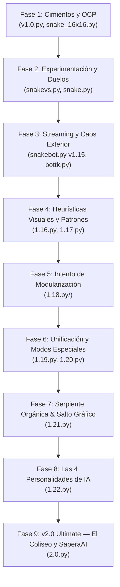

# Process.md — Documentación del Paso a Paso del Proyecto

Este documento detalla la reconstrucción histórica, técnica y analítica de la evolución del proyecto **Snake — The Colosseum & SaperaAI**, así como el backlog vivo de tareas en curso y pendientes.

---

## 1. Resumen Ejecutivo de la Evolución

El proyecto nació como una implementación limpia del clásico juego de la serpiente bajo principios de diseño orientado a objetos (SOLID y OCP). Con el tiempo, el objetivo evolucionó radicalmente: **no se trataba simplemente de construir un juego para que un humano jugara, ni de crear un algoritmo matemático que ganara el juego de la forma más rápida y aburrida posible**, sino de desarrollar un **espectáculo interactivo de streaming en vivo**.

El proyecto se transformó en un sistema de IA autónoma con comportamiento hipnótico y dinámico, capaz de reaccionar en tiempo real a estímulos externos enviados por la audiencia mediante donaciones de TikTok Live (bombas, comida extra, alteraciones de velocidad, cambios estéticos y modos especiales), culminando en **v2.0 Ultimate Edition**: con interfaz de menú interactivo, panel de pausa, cuenta regresiva animada, cinemática 3D de la bomba atómica, 4 modos de juego oficiales y un motor multi-agente con anti-choques y consciencia temporal de eventos.

---

## 2. Línea de Tiempo y Fases Técnicas Completadas

### Fase 1 a 6: Del Motor Clásico a la v1.20 Unificada
- Transición desde el Snake modular inicial hasta la integración de eventos UDP para TikTok Live, los 6 patrones geométricos y el fix de estancamiento en esquinas (`corner-food stall fix`).

### Fase 7: v1.21 — La Serpiente Orgánica y el Salto Gráfico
*Archivo: [`1.21.py`](file:///c:/Users/JSCC2/OneDrive/Documentos/PROYECTOS/SNAKE/1.21.py)*
- Segmentos continuos con cola cónica en el último 15%.
- Rostro vivo con pupilas que siguen la comida y lengua bífida animada.
- Sprites de manzanas con volumen y aura pulsante dorada.

### Fase 8: v1.22 — El Sistema de 4 Personalidades de IA
*Archivo: [`1.22.py`](file:///c:/Users/JSCC2/OneDrive/Documentos/PROYECTOS/SNAKE/1.22.py)*
- Perfiles de personalidad: Tortuga Zen (Conservadora), Guepardo Voraz (Kamikaze), Pitón Real (Territorial) y Camaleón Quántico (Caótica).
- Selector dinámico de personalidades mediante tecla `P`.

### Fase 9: v2.0 Ultimate Edition — Menús, 4 Modos y Fixes de Supervivencia
*Archivo: [`2.0.py`](file:///c:/Users/JSCC2/OneDrive/Documentos/PROYECTOS/SNAKE/2.0.py)*
- **Interfaz Gráfica Completa (Main Menu)**:
  - Selector de los 4 Modos de Juego con tarjetas interactivas.
  - Panel de ayuda de Controles de Teclado.
  - Guía completa de donaciones y regalos de TikTok Live.
  - Branding de autor: **SaperaAI**.
- **Panel de Pausa (Modal con Tecla `K` o `ESC`)**:
  - Modal sobre fondo oscuro con opciones de Reanudar, Reiniciar ronda y Volver al Menú Principal.
- **Cuenta Regresiva Animada (3 Segundos)**:
  - Las serpientes inician congeladas mientras los números 3 $\rightarrow$ 2 $\rightarrow$ 1 $\rightarrow$ ¡START! escalan y se desvanecen en pantalla.
- **HUD Superior Proporcionado**:
  - Estado de conexión TikTok, Modo de Juego, FPS, Eventos activos con temporizador regresivo y donante actual sin sobreescritura de texto.
- **Cinemática Nuclear en Pseudo-3D**:
  - Ojiva cayendo con estela de fuego, aletas y sombra proyectada en el suelo que converge hacia el punto de impacto, seguida de un destello blanco (*impact flash*) y anillos térmicos concéntricos.
- **Eliminación de Muertes Espontáneas**:
  - Corrección de validación de límites `in_bounds` y control de crecimiento diferido en la posición de la cola.
- **Anti-Choque Frontal y Supervivencia Temprana**:
  - Penalización masiva a casillas adyacentes a cabezas rivales para evitar muertes absurdas al inicio de la ronda.
- **Consciencia Temporal del Modo Trascendente**:
  - Los bots anticipan el cierre del portal de wrap faltando 1.4 segundos para no estamparse contra la pared al reactivarse los muros.
  - Preservación de segmentos cortados al expirar el modo wrap.
- **Los 4 Modos de Juego Implementados**:
  1. *Battle Royale (4 Serpientes)*
  2. *Duelo 1v1 (2 Serpientes)*
  3. *Modo Hipnótico (1 Serpiente Espectáculo)*
  4. *Modo Rápido / Speedrun (1 Serpiente)*
- **Creación de [Bases.md](file:///c:/Users/JSCC2/OneDrive/Documentos/PROYECTOS/SNAKE/Bases.md)**:
  - Documento de mandamientos de supervivencia inamovibles. Regla de oro de tolerancia cero al suicidio involuntario.
- **HUD Estricto de 5 Elementos**:
  - Restricción del panel superior a únicamente: Estado TikTok, Modo de Juego, FPS, Nombre de Patrón y Evento activo con temporizador.
- **Suite de Pruebas y Certificación de Resistencia**:
  - Validación 100% exitosa en [`test_engine.py`](file:///c:/Users/JSCC2/OneDrive/Documentos/PROYECTOS/SNAKE/test_engine.py).
  - Simulación extrema de 4,000 ticks en solitario (`SPEEDRUN`: longitud 132 sin muertes; `HYPNOTIC`: 4,000 ticks invicto).

---

## 3. Seguimiento de Tareas y Evolución Continua

### ✅ Tareas Completadas
- [x] Unificar puerto UDP en `8765` en `tk.py` y motores de juego.
- [x] Crear interfaz de Menú Principal con navegación interactiva.
- [x] Diseñar panel de selección para los 4 modos de juego.
- [x] Crear panel de controles de teclado y guía de regalos de TikTok Live.
- [x] Añadir pie de página con branding "SaperaAI".
- [x] Implementar panel de pausa modal (Reanudar, Reiniciar, Menú).
- [x] Programar cuenta regresiva animada de 3 segundos al inicio de ronda.
- [x] Limpiar panel superior (HUD) a estrictamente 5 elementos sin sobreescritura.
- [x] Ajustar textos de menús, controles y guías para evitar desbordamientos y recortes de ventana.
- [x] Diseñar cinemática de Bomba Atómica en perspectiva 3D con sombra proyectada y flash.
- [x] Crear [`Bases.md`](file:///c:/Users/JSCC2/OneDrive/Documentos/PROYECTOS/SNAKE/Bases.md) con los mandamientos sagrados del proyecto y de la IA.
- [x] Reconstruir lógica de supervivencia (`_has_escape` BFS y detección de bolsas vacías) erradicando muertes espontáneas.
- [x] Implementar heurística anti-choque frontal temprano para alargar el espectáculo.
- [x] Integrar consciencia temporal en modo Trascendente (wrap) y preservación de cuerpo.
- [x] Crear [`colosseum_trainer.py`](file:///c:/Users/JSCC2/OneDrive/Documentos/PROYECTOS/SNAKE/colosseum_trainer.py) para simulación masiva y entrenamiento en paralelo en 6 arenas simultáneas (4P/5P en 16x16, 22x22, 32x32 y 48x48) sobre 12 núcleos de CPU.
- [x] Implementar optimización genética (Evolutionary Strategies) con eventos de TikTok Live estocásticos y checkpointing automático en JSON/CSV.
- [x] Validar calibración de 10 segundos en las 6 arenas con guardado de estadísticas en `training_results/`.

- [x] Ejecutar simulación prolongada de 7 horas continuas en paralelo sobre los 6 entornos: **22,124 partidas disputadas**, cero caídas y pesos evolutivos guardados en `training_results/`.
- [x] Crear [`report_status.py`](file:///c:/Users/JSCC2/OneDrive/Documentos/PROYECTOS/SNAKE/report_status.py) para compilación e inspección en vivo de estadísticas y win-rates de las arenas.
- [x] Incorporar los mejores pesos evolucionados de `training_results/` de vuelta al motor gráfico de [`2.0.py`](file:///c:/Users/JSCC2/OneDrive/Documentos/PROYECTOS/SNAKE/2.0.py) e integrar formalmente la 5ª Facción: Basilisco Ámbar (`FactionId.GOLD`, #Dorado).
- [x] Diseñar e implementar la nueva interfaz interactiva `ColosseumSetupScene` al seleccionar "Battle Royale / Coliseo", permitiendo modificar:
  - **Tamaño de la Arena**: 16x16 (Reducido), 22x22 (Normal), 32x32 (Ampliado), 48x48 (Mega Arena).
  - **Cantidad de Gladiadores**: 2, 3, 4 y 5 serpientes simultáneas.
  - **Jinetes y Personalidades**: Selector de slots interactivo con rotación cíclica entre las 5 facciones (Voraz, Zen, Territorial, Mística, Táctico), previsualización de color y descripción táctica.
  - **Botón de Iniciar Batalla**: Lanzamiento instantáneo de `PlayScene` con la configuración exacta elegida.
- [x] Actualizar y superar el 100% de la suite de pruebas automatizadas en [`test_engine.py`](file:///c:/Users/JSCC2/OneDrive/Documentos/PROYECTOS/SNAKE/test_engine.py) validando render, transiciones, clics, teclas de navegación (ESC/ENTER) y simulación multi-arena con 2, 4 y 5 contendientes.

### 📋 Backlog de Tareas Futuras (v2.1+)
- [ ] Efectos de audio retro sintetizados (mordisco, mecha, sirena de bomba atómica).
- [ ] Sistema de metas colectivas de donaciones (Barra de progreso de TikTok Raid).
- [ ] Portales de teletransporte bidireccionales en el Coliseo.

